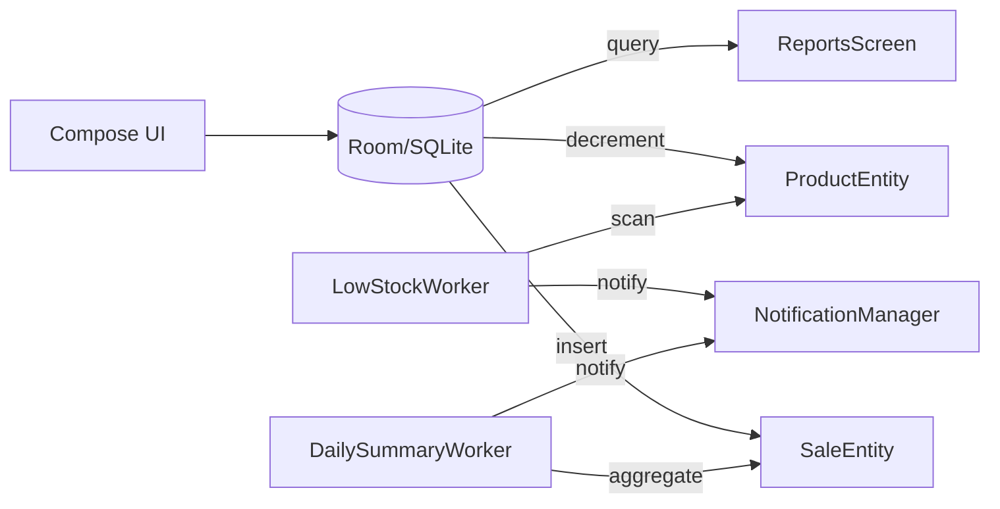

# Aide — Current Architecture Audit (AIDE-01)

*Generated as part of [AIDE-01: Audit current architecture, schema, Android storage and sync](https://github.com/oliver4441/aide/issues/40)*  
*Parent epic: #39 — Build Aide into a Kenya-first accounting and enterprise retail platform*

---

## 1. High-Level Architecture

```
┌─────────────────────────────────────────────────────────────────────────┐
│                           AIDE PLATFORM                                 │
├─────────────────────────────────────────────────────────────────────────┤
│                                                                         │
│   ┌──────────────────────┐         ┌──────────────────────┐           │
│   │      Web / PWA       │         │    Native Android    │           │
│   │   (Next.js 14)       │         │   (Kotlin + Compose) │           │
│   │                      │         │                      │           │
│   │  • IndexedDB (Dexie) │         │  • Room (SQLite)     │           │
│   │  • Outbox + Sync     │         │  • WorkManager Sync  │           │
│   │  • Service Worker    │         │  • Local-only APK    │           │
│   └──────────┬───────────┘         └──────────┬───────────┘           │
│              │                                │                       │
│              └──────────────────┬─────────────┘                       │
│                                 │                                     │
│                                 ▼                                     │
│                      ┌──────────────────────┐                        │
│                      │      Aide API        │                        │
│                      │  (Next.js API Routes)│                        │
│                      │                      │                        │
│                      │  • Auth (NextAuth)   │                        │
│                      │  • Tenant isolation  │                        │
│                      │  • Business logic    │                        │
│                      └──────────┬───────────┘                        │
│                                 │                                     │
│                                 ▼                                     │
│                      ┌──────────────────────┐                        │
│                      │    Neon PostgreSQL   │                        │
│                      │   (Lakebase Postgres)│                        │
│                      └──────────────────────┘                        │
│                                                                         │
└─────────────────────────────────────────────────────────────────────────┘
```

**Key architectural decisions:**
- **Two clients, one API**: Web PWA (offline-first + cloud sync) and Native Android (local-only, no server sync in current build)
- **Android is local-only**: No cloud sync, no authentication against backend. Room is sole source of truth. Business ID generated locally on first launch.
- **Web is offline-first**: IndexedDB (Dexie) is client source of truth. UUIDs generated client-side. Sync engine pushes to `/api/sync` when online.
- **Tenant isolation enforced at API layer**: `requireBusiness()` validates membership before any data access. Admin role does not bypass tenant checks.
- **Deterministic conflict resolution**: LWW by `updatedAt` for descriptive fields; append-only for sales; movement-ledger for stock reconciliation.

---

## 2. Database Schema (Prisma / Neon PostgreSQL)

### Core Models

| Model | Purpose | Key Fields | Indexes |
|-------|---------|------------|---------|
| `Admin` | Platform admin users | `id`, `email`, `passwordHash`, `role` | `@@unique([email])` |
| `User` | Business owners | `id`, `email`, `name`, `passwordHash`, `phone` | `@@unique([email])` |
| `Business` | Tenant/shop entity | `id`, `name`, `type`, `slug`, `currency`, `taxRate`, `receiptFooter`, `logoUrl` | `@@unique([slug])` |
| `BusinessMembership` | User↔Business link | `id`, `userId`, `businessId`, `role` (OWNER/MANAGER/STAFF) | `@@unique([userId, businessId])` |
| `Category` | Product categories | `id`, `businessId`, `name`, `sortOrder` | `@@unique([businessId, name])` |
| `Product` | Inventory items | `id`, `businessId`, `categoryId`, `name`, `sku`, `buyingPrice`, `sellingPrice`, `quantity`, `lowStock`, `isService`, `imageUrl`, `isActive` | — |
| `Sale` | Sales transactions | `id`, `businessId`, `total`, `cost`, `profit`, `paid`, `change`, `tax`, `taxRate`, `paymentMethod`, `cashier`, `notes` | — |
| `SaleItem` | Sale line items | `id`, `saleId`, `productId`, `name`, `quantity`, `price`, `cost` | — |
| `Review` | Customer feedback | `id`, `businessId`, `userId`, `rating`, `categories` (JSON), `comment`, `contactEmail` | — |
| `SyncConflict` | Offline sync conflicts | `id`, `entityType`, `entityId`, `clientData` (JSON), `serverData` (JSON), `resolution`, `status`, `businessId` | — |
| `Notification` | Server-side notifications | `id`, `userId`, `businessId`, `type`, `channel`, `title`, `message`, `data` (JSON), `read`, `deletedAt`, `expiresAt` | `@@index([userId, businessId, createdAt])`, `@@index([userId, read])` |
| `NotificationPreference` | Per-user notification prefs | `id`, `userId`, `businessId`, `type`, `enabled` | `@@unique([userId, businessId, type])` |

### Enums
- `AdminRole`: SUPER_ADMIN, ADMIN, SUPPORT
- `BusinessType`: SALON, SHOP, RESTAURANT, GROCERY, PHARMACY, ELECTRONICS, CLOTHING, OTHER
- `BusinessRole`: OWNER, MANAGER, STAFF
- `PaymentMethod`: CASH, MOBILE_MONEY, CARD, OTHER

### Schema Gaps Identified
1. **No organization/branch hierarchy** — `Business` is flat; multi-location not modeled (tracked in AIDE-02, now merged via PR #66)
2. **Double-entry accounting** — General ledger, chart of accounts, posting engine, period controls, year-end closing, and fixed-asset depreciation are implemented on web (AIDE-05, AIDE-07)

3. **Monetary precision** — Web uses `Decimal(19,4)` throughout (AIDE-04 done); the Android local store still uses `Double`
4. **Audit trail** — Append-only `AuditEvent` records credential logins, role changes, and access revocation (AIDE-19); broader financial posting events are still being wired

5. **No supplier/purchase order models** — Only `Product` has `buyingPrice`; no purchasing workflow (AIDE-09)
6. **No customer credit/AR** — `CustomerEntity` exists in Android Room with `balance`, but no server-side counterpart
7. **No expense categories chart** — `ExpenseEntity` has free-text `category`; no standardized CoA

---

## 3. API Routes (Next.js App Router)

| Route | Auth | Methods | Purpose |
|-------|------|---------|---------|
| `/api/auth/[...nextauth]` | Public | GET, POST | NextAuth session endpoints |
| `/api/auth/register` | Public | POST | Creates User + Business + OWNER membership |
| `/api/auth/mobile-login` | Public | POST | JSON login for native clients → HS256 bearer token |
| `/api/business` | Protected | GET, PATCH, POST | Current user's business profile CRUD |
| `/api/products` | Protected | GET, POST, PUT, DELETE | Product CRUD (tenant-scoped) |
| `/api/categories` | Protected | GET, POST, PUT, DELETE | Category CRUD (tenant-scoped) |
| `/api/sales` | Protected | GET, POST | Sales CRUD (tenant-scoped) |
| `/api/sync` | Protected | GET (pull), POST (push) | Offline sync endpoint |
| `/api/reviews` | Public POST, Admin GET | POST, GET | Reviews submission + admin dashboard |
| `/api/notifications` | Protected | GET, PATCH | Notification center + preferences |
| `/api/releases` | Public | GET | Android release list for `/downloads` |
| `/api/dashboard/*` | Protected | GET | Aggregated metrics for dashboard |
| `/api/admin/*` | Admin only | GET | Admin-only endpoints |

### Auth Flow
- **Web**: Email/password → NextAuth credentials provider → session cookie (JWT in cookie). Session carries `role` (admin/user) + `businessId`.
- **Native (legacy)**: `/api/auth/mobile-login` returns 30-day HS256 bearer token. `requireUser()` accepts `Authorization: Bearer <token>`.
- **Android (current)**: **No auth** — app is local-only. `LocalBusinessStore` generates stable `businessId` on first launch.

### Tenant Isolation
All data routes call `requireBusiness(requestedBusinessId?)`:
1. Resolves user from session or bearer token
2. Fetches all `BusinessMembership` for user
3. If `requestedBusinessId` provided AND user is member → use it
4. Else → fall back to first membership
5. **Admin role never bypasses membership check**

---

## 4. Web Offline-First Stack (Dexie / IndexedDB)

### Dexie Schema (`src/lib/db.ts` v3)

| Table | Key Fields | Sync Status |
|-------|------------|-------------|
| `products` | `id`, `businessId`, `categoryId`, `name`, `syncStatus`, `updatedAt` | `synced` \| `pending` \| `conflict` |
| `categories` | `id`, `businessId`, `name`, `syncStatus` | `synced` \| `pending` \| `conflict` |
| `sales` | `id`, `businessId`, `createdAt`, `syncStatus`, `deviceId` | `synced` \| `pending` \| `conflict` |
| `saleItems` | `id`, `saleId`, `productId` | — |
| `businesses` | `id`, `slug` | — |
| `syncQueue` | `++key`, `action`, `table`, `recordId`, `timestamp`, `status`, `attempts` | `pending` \| `retry` \| `quarantined` \| `synced` |
| `syncConflicts` | `id`, `entityType`, `entityId`, `status`, `createdAt` | — |
| `notifications` | `id`, `businessId`, `type`, `read`, `createdAt` | — |
| `notificationPrefs` | `key` | — |

### Sync Engine (`src/lib/sync.ts`)
- **Auto-sync interval**: 30 seconds when online
- **Outbox pattern**: Mutations enqueued in `syncQueue` with `deviceId`, retried with exponential backoff (1hr threshold, max 5 attempts)
- **Push**: POST `/api/sync` with mutations array; server resolves conflicts via `resolveConflict()`; batch deletes queue items on success
- **Pull**: GET `/api/sync?since=<timestamp>&businessId=<id>`; bulk-upserts into Dexie; updates `aide_last_sync` in localStorage
- **Seed on first login**: `DashboardInit` calls `seedFromSession(businessId)` to pull all data

### Conflict Resolution (`src/lib/conflicts.ts`)
- **Products**: LWW by `updatedAt`; tie-break by `deviceId` (lexicographic)
- **Sales**: Always `client-wins` (append-only)
- **Stock oversell check**: Movement-ledger replay; if any movement would drive qty < 0 → `manual-review` conflict
- **Server-wins** for stale client updates; conflicts stored in `SyncConflict` for owner review

---

## 5. Android Local-Only Stack (Room / WorkManager)

### Room Schema (`AideDatabase` v4)

| Entity | Table | Key Fields | Notes |
|--------|-------|------------|-------|
| `ProductEntity` | `products` | `id` (PK), `businessId`, `categoryId`, `name`, `sku`, `buyingPrice`, `sellingPrice`, `quantity`, `lowStock`, `isService`, `imageUrl`, `isActive`, `createdAt`, `updatedAt` | — |
| `CategoryEntity` | `categories` | `id` (PK), `businessId`, `name`, `sortOrder`, `createdAt` | — |
| `SaleEntity` | `sales` | `id` (PK), `businessId`, `total`, `cost`, `profit`, `paid`, `change`, `tax`, `taxRate`, `cashier`, `paymentMethod`, `notes`, `createdAt` | — |
| `SaleItemEntity` | `sale_items` | `id` (PK), `saleId`, `productId`, `name`, `quantity`, `price`, `cost` | — |
| `NotifiedEventEntity` | `notified_events` | `eventId` (PK), `channel`, `title`, `message`, `route`, `read`, `createdAt` | Idempotency log + inbox |
| `ExpenseEntity` | `expenses` | `id` (PK), `businessId`, `category`, `description`, `amount`, `isCogs`, `notes`, `createdAt` | Indexed by `businessId`, `createdAt` |
| `CustomerEntity` | `customers` | `id` (PK), `businessId`, `name`, `phone`, `email`, `notes`, `balance`, `isActive`, `createdAt`, `updatedAt` | `balance` denormalized for credit sales |

### Migrations
- **v1→v2**: Added `notified_events` table (notification log)
- **v2→v3**: (implicit — schema changes)
- **v3→v4**: Added `expenses` + `customers` tables with indexes
- **No destructive fallback** — migrations are explicit to preserve local data

### Background Workers (`android/app/src/main/java/com/omix/aide/work/`)
| Worker | Schedule | Purpose |
|--------|----------|---------|
| `LowStockWorker` | Periodic (6h), max 1/day | Scan products → notify if `quantity <= lowStock` |
| `DailySummaryWorker` | Daily at user-set time (default 18:00) | Aggregate sales/expenses → notification |

### Notification System
- **Channels**: `low_stock_sounded`, `low_stock_silent`, `daily_summary_sounded`, `daily_summary_silent` (sound frozen at creation; matching channel kept)
- **Sounds**: `res/raw/till_chime.ogg`, `res/raw/warning_chime.ogg`
- **Rich notifications**: `InboxStyle` with one line per product/figure
- **In-app center**: `NotificationCenterSheet` (unread badge, mark one/all read)
- **Dedup**: `eventId` in `notified_events`; pruned after 90 days
- **No FCM / no remote push** — purely on-device

### Local Business ID
- `LocalBusinessStore` generates stable `businessId` on first launch (stored in SharedPreferences)
- Uninstalling app deletes all data (warned on More screen → export first)

---

## 6. Authentication & Authorization

### Web (NextAuth)
- **Provider**: Credentials (email + bcrypt password)
- **Tables**: `User` (owners), `Admin` (platform admins)
- **Session**: JWT in httpOnly cookie, carries `role` + `businessId`
- **Admin emails**: `ADMIN_EMAILS` env var (comma-separated)

### API Authorization (`src/lib/apiAuth.ts`)
```typescript
requireBusiness(requestedBusinessId?) → { user, businessId, businessIds[] }
```
- Validates membership via `BusinessMembership`
- Falls back to first membership if none specified
- **Never** uses `prisma.business.findFirst()` as tenant default
- Admin status **does not** bypass membership check

### Android (Current)
- **No authentication** — app is local-only
- `LocalBusinessStore` provides stable local `businessId`
- No user accounts, no roles, no server communication

---

## 7. Deployment & Release Pipeline

### Web (PWA)
- **Platform**: Vercel (auto-deploy on push to `master`)
- **Build**: `npm run build` (Next.js static export for PWA)
- **CI**: `.github/workflows/web-build.yml` — type-check, lint, build (npm + pnpm layouts)
- **Env**: `DATABASE_URL`, `NEXTAUTH_SECRET`, `ADMIN_EMAILS` in Vercel
- **PWA**: `manifest.webmanifest` + `sw.js` (cache-first static, network-first navigation)

### Android
- **CI**: `.github/workflows/android-ci.yml` — unit tests, lint, assembleDebug + assembleRelease, device tests on API 24/35
- **Release**: `.github/workflows/android-release.yml`
  - Trigger: push `v*` tag OR `workflow_dispatch`
  - Validates production keystore signing (secrets: `ANDROID_KEYSTORE_BASE64`, `ANDROID_STORE_PASSWORD`, `ANDROID_KEY_ALIAS`, `ANDROID_KEY_PASSWORD`)
  - Derives `versionCode` from tag suffix (`v1.0.13+1013` → 1013)
  - In-place upgrade test against previous release + v1.0.12 baseline
  - Publishes signed `aide-{version}.apk` + `android-update.json` to GitHub Release
  - Commits SHA-256 checksums to `public/apk-checksums.json` on `master`
- **Artifacts**: Signed APK (universal), SHA-256, changelog, updater manifest
- **No AAB/Play Store** yet — direct APK distribution

### Desktop (Deprecated)
- `.github/workflows/release-desktop.yml` exists but only triggers on `desktop-v*` tags
- Electron build in `electron/` folder (not used by current product)
- Issue #19 closed — desktop builds dropped

---

## 8. Data Flow Summary

### Web: Sale Creation (Offline-First)
```
User taps "Complete Sale" in POS
         │
         ▼
Create Sale + SaleItems in Dexie (client-generated UUIDs)
         │
         ▼
Decrement Product.quantity locally (optimistic)
         │
         ▼
Enqueue mutations to syncQueue (create sale, update products)
         │
         ▼
Show receipt immediately (local data)
         │
         ▼ (when online, 30s auto-sync)
Push syncQueue → /api/sync
         │
         ▼
Server: validate membership, resolve conflicts, persist
         │
         ▼
Pull latest → merge into Dexie (bulkPut)
         │
         ▼
Update syncStatus to 'synced', clear queue
```

### Android: Sale Creation (Local-Only)
```
User taps "Complete Sale" in POS
         │
         ▼
Create Sale + SaleItems in Room (client-generated UUIDs)
         │
         ▼
Decrement Product.quantity locally
         │
         ▼
Show receipt immediately
         │
         ▼ (no sync — data stays on device)
LowStockWorker / DailySummaryWorker may trigger notifications
```

---

## 9. Gap Register (Classified)

| Area | Workflow | Status | Notes |
|------|----------|--------|-------|
| **Auth** | Web email/password login | ✅ Implemented | NextAuth credentials provider |
| **Auth** | Admin SSO / OAuth | ❌ Missing | Only email/password; no OAuth providers |
| **Auth** | Native mobile login | ✅ Implemented (legacy) | `/api/auth/mobile-login` returns bearer token; unused by current Android |
| **Auth** | Android local auth (PIN/biometric) | ❌ Missing | App opens directly to data |
| **Tenant** | Single business per user | ✅ Implemented | `BusinessMembership` with roles |
| **Tenant** | Multi-business per user | ✅ Implemented | User can have multiple memberships |
| **Tenant** | Organization/branch hierarchy | ✅ Partial | PR #66 added `Organization` + `Location` models |
| **Tenant** | Employee invites / access lifecycle | ❌ Missing | AIDE-03 |
| **Products** | CRUD + categories + images | ✅ Implemented | Base64 images in Dexie/Room |
| **Products** | Barcode scanning | ✅ Android only | ML Kit barcode scanning |
| **Products** | Variants / bundles | ❌ Missing | AIDE-15 |
| **Products** | Costing methods (FIFO/Avg) | ❌ Missing | AIDE-10 |
| **Sales** | POS cart + checkout | ✅ Implemented | Cash, M-Pesa, Card |
| **Sales** | Receipt print (thermal + A4) | ✅ Implemented | `ReceiptDocument.tsx` / `ReceiptScreen.kt` |
| **Sales** | Credit sales / customer balance | ✅ Android only | `CustomerEntity.balance` denormalized |
| **Sales** | Multi-terminal / shifts / drawers | ❌ Missing | AIDE-11 |
| **Sales** | Refunds / voids | ❌ Missing | No reversal workflow |
| **Inventory** | Stock adjustment / movement log | ❌ Missing | Only sale-driven decrement; AIDE-10 |
| **Inventory** | Multi-warehouse | ❌ Missing | AIDE-10 |
| **Inventory** | Goods receiving / PO | ❌ Missing | AIDE-09 |
| **Expenses** | Expense capture + categories | ✅ Android only | `ExpenseEntity` in Room; no web/server |
| **Expenses** | COGS tracking | ❌ Missing | `isCogs` flag exists but unused |
| **Reports** | Revenue chart (7d) | ✅ Implemented | SVG bar chart |
| **Reports** | Top products / payment breakdown | ✅ Implemented | |
| **Reports** | P&L / Balance Sheet / Cash Flow | ❌ Missing | AIDE-07 |
| **Reports** | Accounting period controls | ❌ Missing | AIDE-07 |
| **Sync** | Web push/pull + conflict UI | ✅ Implemented | `SyncEngine`, `SyncConflict` model |
| **Sync** | Android cloud sync | ❌ Missing | Android is local-only by design |
| **Sync** | Cross-device sync (same business) | ❌ Missing | No multi-device for Android |
| **Notifications** | Low stock (on-device) | ✅ Android | `LowStockWorker` |
| **Notifications** | Daily summary (on-device) | ✅ Android | `DailySummaryWorker` |
| **Notifications** | Server push (web) | ❌ Missing | Only in-app `Notification` model |
| **Notifications** | FCM / remote push | ❌ Missing | Not planned |
| **Settings** | Business profile | ✅ Implemented | Name, type, currency, tax, footer |
| **Settings** | Category management | ✅ Implemented | |
| Settings | Sync conflict review | ✅ Web | `SyncConflict` list in Settings |
| Settings | Data export (CSV/JSON) | ✅ Implemented | Sales, products |
| Settings | Backup/restore | ❌ Missing | No full backup workflow |
| **Deployment** | Web auto-deploy (Vercel) | ✅ Implemented | |
| **Deployment** | Android signed release | ✅ Implemented | Tag-push + workflow_dispatch |
| **Deployment** | Android AAB / Play Store | ❌ Missing | AIDE-18 |
| **Deployment** | Automated rollback | ❌ Missing | AIDE-19 |
| **Observability** | Error tracking (Sentry) | ❌ Missing | AIDE-19 |
| **Observability** | Audit logging | ❌ Missing | AIDE-19 |
| **Observability** | Metrics / dashboards | ❌ Missing | AIDE-19 |

---

## 10. Data Migration Risks & Rollback Strategy

| Risk | Impact | Likelihood | Mitigation |
|------|--------|------------|------------|
| `Float` → `Decimal` monetary migration | Data corruption / precision loss | High (AIDE-04) | 1. Add `Decimal` columns alongside `Float`<br>2. Backfill with rounding audit<br>3. Dual-write period<br>4. Cutover with verification |
| Organization/branch hierarchy (PR #66) | Breaks existing single-business queries | Medium | Backfill script (`prisma/org-backfill.sql`) creates default org/location per business; all queries scoped to `businessId` |
| Android Room schema v4 migration | App crash on upgrade if migration SQL mismatches | Low | Explicit migrations tested in `DatabaseUpgradeTest`; no destructive fallback |
| Sync conflict resolution changes | Divergent data between clients | Medium | Deterministic resolver; conflicts surfaced for owner review; never auto-discard |
| Removing desktop builds | Orphaned release assets | Low | Issue #19 closed; existing `desktop-v1.0.0` assets left as-is (marked unsupported) |

**Rollback Strategy:**
- **Web**: Vercel instant rollback to previous deployment (immutable deployments)
- **Android**: Previous signed APK remains on GitHub Releases; users can side-load downgrade (in-place downgrade blocked by Android — must uninstall, hence export warning)
- **Database**: Neon instant restore (point-in-time recovery, 7-day default); Prisma migrations are forward-only — compensating migrations required for rollback

---

## 11. Recommended Implementation Sequence (Linked to Epic #39)

### Phase 1: Foundation (Weeks 1-4)
| Issue | Title | Dependency |
|-------|-------|------------|
| AIDE-01 | ✅ **Audit complete** (this doc) | — |
| AIDE-02 | ✅ **Organization + Location hierarchy** (PR #66 merged) | AIDE-01 |
| AIDE-04 | Migrate monetary fields to exact decimal | AIDE-01 |
| AIDE-03 | Tenant-scoped RBAC, employee membership | AIDE-02 |

### Phase 2: Accounting Core (Weeks 5-10)
| Issue | Title | Dependency |
|-------|-------|------------|
| AIDE-05 | Double-entry accounting schema + posting engine | AIDE-04 |
| AIDE-06 | Connect POS/payments/expenses to GL | AIDE-05 |
| AIDE-07 | Core financial statements + period controls | AIDE-05 |
| AIDE-04 | (continues) Decimal migration completion | — |

### Phase 3: Commercial Operations (Weeks 11-18)
| Issue | Title | Dependency |
|-------|-------|------------|
| AIDE-08 | Customers, quotations, invoices, AR | AIDE-03, AIDE-05 |
| AIDE-09 | Suppliers, purchasing, GRN, AP | AIDE-05 |
| AIDE-10 | Inventory movement ledger, costing, multi-warehouse | AIDE-05 |
| AIDE-11 | Multi-terminal POS, shifts, cash drawers | AIDE-06 |
| AIDE-12 | Enterprise approval workflows, SoD | AIDE-03 |
| AIDE-13 | Cash office, till reconciliation | AIDE-06, AIDE-11 |

### Phase 4: Scale & Compliance (Weeks 19-28)
| Issue | Title | Dependency |
|-------|-------|------------|
| AIDE-14 | Head-office multi-branch, consolidated reporting | AIDE-02, AIDE-07 |
| AIDE-15 | Supermarket product, barcode, pricing, promotions | AIDE-10 |
| AIDE-16 | Banking, M-Pesa, payment reconciliation | AIDE-06 |
| AIDE-17 | Kenya tax engine, eTIMS integration | AIDE-07 |
| AIDE-18 | Shared offline-first multi-user (Android + Web sync) | AIDE-01, AIDE-03 |
| AIDE-19 | Security, audit, observability, DR | AIDE-07, AIDE-05 |
| AIDE-20 | Accountant collaboration, public API, integrations | AIDE-07, AIDE-19 |
| AIDE-21 | Reporting, budgets, forecasting, Aide Intelligence | AIDE-07, AIDE-14 |

---

## 12. Current-State Diagrams

### 12.1 Web Data Flow (Offline-First)
```mermaid
flowchart LR
    UI[React UI] --> Dexie[(IndexedDB/Dexie)]
    Dexie -->|enqueue| SyncQueue[syncQueue table]
    SyncQueue -->|push 30s| API[/api/sync POST]
    API -->|resolve| Conflicts[(SyncConflict)]
    API --> Neon[(Neon PostgreSQL)]
    Neon -->|pull| API2[/api/sync GET]
    API2 -->|bulkPut| Dexie
```

### 12.2 Android Data Flow (Local-Only)


### 12.3 Tenant Isolation Boundary
```mermaid
flowchart TD
    Request[API Request] --> Auth{requireUser}
    Auth -->|session or bearer| User[SessionUser]
    User --> Memberships[BusinessMembership\nwhere userId = ?]
    Memberships -->|list| BusinessIds[businessId[]]
    Request -->|optional| ReqBiz[requestedBusinessId]
    ReqBiz -->|in BusinessIds?| Allow[Use requested]
    Allow -->|no| Default[Use first membership]
    Default --> BusinessId[businessId for query]
```

---

## 13. Appendix: Key Files Reference

| Layer | File | Purpose |
|-------|------|---------|
| **Schema** | `prisma/schema.prisma` | PostgreSQL schema (17 models) |
| **Schema** | `prisma/seed.ts` | Test data (admin, user, 2 businesses, 17 products, 15 sales) |
| **Auth** | `src/lib/auth.ts` | NextAuth credentials config (dual User/Admin) |
| **Auth** | `src/lib/apiAuth.ts` | Route authorization + tenant scoping |
| **Auth** | `src/lib/mobileAuth.ts` | HS256 token for native clients |
| **DB** | `src/lib/db.ts` | Dexie schema v3 (9 tables) |
| **DB** | `src/lib/prisma.ts` | Prisma client singleton |
| **Sync** | `src/lib/sync.ts` | SyncEngine (push/pull/auto-sync/seed) |
| **Sync** | `src/lib/conflicts.ts` | Deterministic resolver (LWW + stock check) |
| **Sync** | `src/lib/syncBackfill.ts` | Stale queue processor (retry/backoff) |
| **Android DB** | `android/.../AideDatabase.kt` | Room v4 (7 entities, 2 migrations) |
| **Android DB** | `android/.../entities/Entities.kt` | Room entity definitions |
| **Android Sync** | `android/.../work/*.kt` | WorkManager workers (low-stock, daily summary) |
| **API** | `src/app/api/sync/route.ts` | Sync endpoint (push/pull, conflict handling) |
| **API** | `src/app/api/business/route.ts` | Business profile CRUD |
| **CI** | `.github/workflows/android-release.yml` | Signed APK pipeline |
| **CI** | `.github/workflows/web-build.yml` | Web build guard |
| **CI** | `.github/workflows/android-ci.yml` | Android unit/lint/device tests |

---

*End of audit. Next: Begin AIDE-04 (Decimal monetary migration) or AIDE-03 (RBAC) per implementation sequence.*