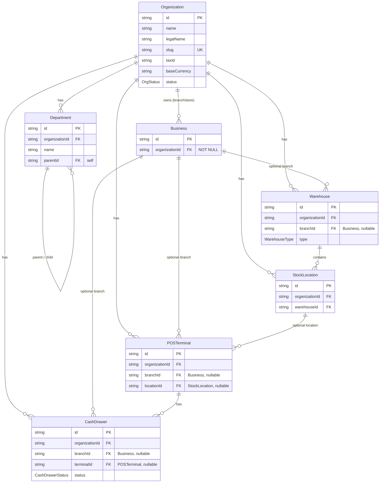

# AIDE-02 — Organisation, branch, department & location hierarchy

Status: **first milestone (design + schema + backwards-compatible backfill)**.
Part of epic #39. Depends on the current-state understanding captured in AIDE-01.

This document is the ERD + migration plan that AIDE-02 requires to be reviewed
**before** implementation. It also records the design decisions so later
milestones (AIDE-03 RBAC, AIDE-11 POS terminals, the accounting ledger, …) can
build on a stable foundation.

## Goal

Introduce the shared company model that multi-branch retailers and enterprises
need, without breaking the existing single-business experience:

- A **legal entity / Organisation** that owns everything else.
- **Branches / stores** — in this codebase an existing `Business` *is* the
  operational branch/store, so we attach it to an Organisation rather than
  renaming it.
- **Departments / cost centres** (with an optional parent for sub-units).
- **Warehouses / stock rooms** and **stock locations** (bins / shelves / zones).
- **POS terminals** (checkout lanes) and **cash drawers**.

Every tenant-owned record remains addressable by its existing `businessId`
boundary; the new `organizationId` on `Business` adds the company dimension on
top, so no existing route, sync contract, or Android payload changes in this
milestone.

## ERD (entity relationships)

## Schema additions (`prisma/schema.prisma`)

- `enum OrgStatus { ACTIVE ARCHIVED }`
- `model Organization` — the company. `slug` is unique; one per legal entity.
- `Business.organization` / `Business.organizationId` — **required** relation
  (`String`, NOT NULL) with `onDelete: Restrict`, plus `@@index([organizationId])`.
  Every Business is linked to exactly one Organization; legacy rows are backfilled
  and the column is tightened to NOT NULL by `prisma/org-backfill.sql`.
- `model Department` — `organizationId`, optional `parentId` self-relation
  (`DepartmentHierarchy`), `costCentre`, `active`. Unique `(organizationId, name)`.
- `enum WarehouseType { WAREHOUSE STOCK_ROOM }`
- `model Warehouse` — `organizationId`, optional `branchId` (→ `Business`),
  `type`, `address`.
- `model StockLocation` — `organizationId`, `warehouseId`, `zone`.
- `model POSTerminal` — `organizationId`, optional `branchId` + `locationId`,
  `active`, `openedAt`.
- `enum CashDrawerStatus { CLOSED OPEN }`
- `model CashDrawer` — `organizationId`, optional `branchId` + `terminalId`,
  `status`, `openedAt`, `openedBy`.

All new models cascade-delete from their `Organization` (`onDelete: Cascade`)
except where a nullable `branchId`/`locationId`/`terminalId` uses `SetNull`.
`Business.organization` uses `Restrict` so an org that still owns businesses
cannot be deleted.

## Migration strategy (backwards-compatible for existing data)

The repo applies schema via `prisma db push` (no Prisma migrations folder, and
CI only runs `tsc` + `next build`). `business.organizationId` is a **required,
NOT NULL** column; `prisma/org-backfill.sql` is what makes that safe on a
populated database:

1. `npx prisma db push` creates the new tables and the
   `business."organizationId"` FK column. On a database that already contains
   Business rows, run the backfill (step 2) first so the column is added and
   populated as nullable before it is tightened to NOT NULL.
2. `psql "$DATABASE_URL" -f prisma/org-backfill.sql` creates one Organization
   per existing Business (slug-derived), links every Business, then `ALTER`s the
   column to `NOT NULL` and adds the FK. Idempotent / re-runnable.

### Existing single-business accounts

- Every pre-existing `Business` gets exactly one owning `Organization` (1:1),
  created by the backfill keyed on the existing unique `slug`.
- New signups already create their own Organization in
  `src/app/api/auth/register/route.ts` and in
  `src/app/api/business/route.ts` (the "create my business" endpoint), so the
  model stays coherent for future accounts too.

### Platform placeholder (resolved)

`src/app/api/reviews/route.ts` lazily creates a single platform placeholder
`Business` (`aide-platform-reviews`) to attribute anonymous reviews. It now also
creates a platform `Organization` (`aide-platform`) and links the placeholder to
it, and self-heals any legacy placeholder row that predates AIDE-02 (nullable
`organizationId`). So every `Business` is org-owned; no row is left unlinked.

## Tenant isolation (unchanged this milestone)

`src/lib/apiAuth.ts` continues to resolve access via `businessId`. The
organisation boundary is *derived* from `Business → Organization`. Enforcing
org- and branch-scoped authorization server-side is explicitly **AIDE-03** work
and is intentionally out of scope here so this change ships without touching
every data route.

### Authorization foundation (added this milestone)

The shared, pure selection primitive `selectAccessible` (`src/lib/accessSelect.mjs`)
is now used by `requireBusiness`, and two org-scoped resolvers were added to
`src/lib/apiAuth.ts`:

- `getAccessibleOrganizationIds(user)` — distinct orgs a user belongs to, via
  their business memberships.
- `resolveOrganization(requestedOrganizationId, request)` — mirrors
  `requireBusiness` at the company level: a requested org is honoured only when
  the caller is a member, otherwise it falls back to the first org. Never
  returns an org the caller does not belong to.

These are the primitives AIDE-03 (RBAC) will extend with role/permission
checks; they do not yet enforce any role. A cross-tenant isolation unit test
lives at `scripts/tests/org-access.test.mjs` (pure, no DB), covering the
"never leak another tenant's id" rule.

## What is NOT in this milestone (follow-ups)

- Org-scoped RBAC, invitations, suspension/offboarding → **AIDE-03**.
- ~~Tightening `business.organizationId` to `NOT NULL`~~ — **done**: the column is
  now required in the schema and `prisma/org-backfill.sql` enforces it (populate
  + `SET NOT NULL` + FK) on existing data.
- Moving the operational boundary from `businessId` to
  `organizationId` + branch dimensions in data routes and the sync engine.
- Cashier shifts / till float on `CashDrawer` → **AIDE-11**.
- Multi-currency / per-org settings beyond `baseCurrency`.

## Acceptance-criteria mapping

- ERD + migration plan reviewed before implementation → this document. ✅
- Every tenant-owned record has an explicit organisation boundary and
  applicable location dimensions → `Organization` model + `Business.organizationId`
  present; location models added. (Enforcement is AIDE-03.) ✅ (schema)
- Existing single-business accounts map safely → backfill script. ✅
- Cross-organisation / cross-branch isolation tests specified →
  `scripts/tests/org-access.test.mjs` covers the cross-tenant selection rule, and
  the org-scoped resolvers in `src/lib/apiAuth.ts` derive org scope from
  business membership. Branch-dimension enforcement is AIDE-03 / AIDE-11 work.
